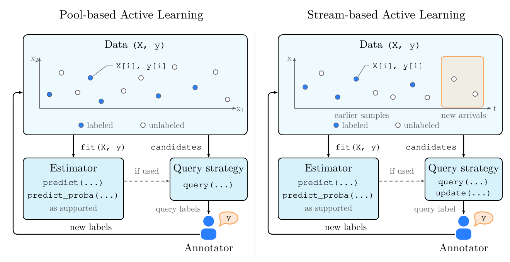

.. _core-workflow:
.. _concepts:

========
Concepts
========

In active learning, a query strategy selects which samples to label for
training an estimator. Annotators provide the labels of the selected samples.
scikit-activeml supports pool-based and stream-based active learning.

.. _the-label-vector-y:
.. _choosing-the-missing-label:
.. _common-pitfalls:

Components and Responsibilities
===============================

      strategy, and an annotator. Labeled and unlabeled samples appear
      together. Current stream candidates are highlighted among the arrivals.
      API labels show query, fit, and prediction methods, with update on the
      stream query strategy.
   :width: 100%
   :align: center

   Each marker represents a sample in ``X``, with its fill indicating whether
   its label in ``y`` is known. The stream panel highlights the current
   ``candidates``. Estimator predictions can inform the query strategy,
   depending on the method.

scikit-activeml provides estimators and query strategies. Your application
manages the data, queries annotators for labels, and controls training and
stopping. The feature matrix ``X`` describes the samples. The label array
``y`` stores known labels and marks unknown labels with ``missing_label``.

.. _the-active-learning-cycle:
.. _pool-and-stream-acquisition:
.. _pool-based-classification:
.. _candidates-batches-and-utilities:
.. _pool-based-acquisition:
.. _stream-based-active-learning:
.. _stream-based-acquisition:

Pool-based and Stream-based Active Learning
===========================================

.. list-table::
   :header-rows: 1
   :widths: 20 40 40

   * -
     - Pool-based active learning
     - Stream-based active learning
   * - Samples
     - An available pool of samples can be considered across successive
       queries.
     - Samples arrive over time and are considered as they arrive.
   * - Selection
     - A pool-based query strategy selects one sample or a batch of samples
       whose labels are to be queried.
     - A stream-based query strategy decides whether to query the labels of
       arriving samples. It can skip all current samples.
   * - Budget
     - The application can stop when its labeling budget is exhausted.
     - The query strategy controls the fraction of arriving samples whose
       labels are queried.

Both use ``query()`` to select samples. Stream-based query strategies also
use ``update()`` to advance their state after each decision, including when
no label is queried. Training the estimator is a separate operation.
For runnable examples, see the :doc:`pool-based
<generated/tutorials/00_pool_getting_started>` and :doc:`stream-based
<generated/tutorials/20_stream_getting_started>` tutorials.

.. _workflow-variations:
.. _regression:
.. _multi-label-classification:

Learning Settings
=================

The task, target type, and annotation type describe different aspects of the
labels used for learning.

.. The former Multiple Annotators heading supplied a local HTML anchor.
   Keep it local because target_semantics.rst owns the global Sphinx label.

.. raw:: html

   

.. list-table::
   :header-rows: 1
   :widths: 22 78

   * - Property
     - Options
   * - Task
     - **Classification:** predict class labels.
       **Regression:** predict continuous labels.
   * - Target type
     - **Single-output:** one prediction value per sample.
       **Multi-label:** a vector of binary label assignments per sample.
   * - Annotation type
     - **Single-annotator:** one annotator's label or label vector per sample.
       **Multi-annotator:** labels stored separately for each annotator.

For multi-label classification, a query selects samples whose complete label
vectors are to be queried. Multi-annotator query strategies select
sample-annotator pairs, identifying both the samples and the annotators to
query for their labels.

The supported combinations depend on the estimator and query strategy. Use
the :doc:`Strategy Overview <generated/strategy_overview>` to find query
strategies for your setting. The :doc:`Target and Annotation Semantics
<target_semantics>` page defines label representations and current limits,
including the lack of support for general multi-output classification and
regression or for multi-label classification with multiple annotators.

Where to Go Next
================

* :doc:`Tutorials <tutorials>` provide runnable examples for the
  different learning settings.
* The :doc:`API Reference <generated/api/skactiveml>` documents the parameters
  and behavior of estimators and query strategies.
