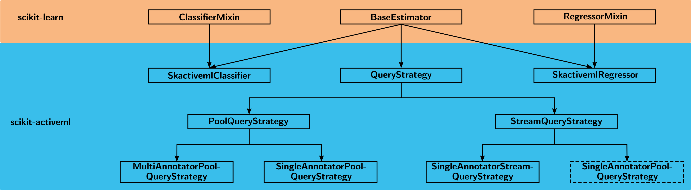

Contributing
============

**scikit-activeml** is a library that implements the most important query
strategies for active learning. It is built upon the well-known machine
learning framework `scikit-learn <https://scikit-learn.org/stable/>`__.

Overview
--------

Our philosophy is to extend the scikit-learn ecosystem with the most relevant
query strategies for active learning and to implement tools for working with
partially unlabeled data. An overview of our repository's structure is provided
in the image below. Each node represents a class or interface, and the arrows
illustrate the inheritance hierarchy among them. Dashed nodes indicate
functionality that is not yet available in our library. scikit-learn
is used in this image for identification only and does not imply endorsement.

In our package ``skactiveml``, there are three major components:
``SkactivemlClassifier``, ``SkactivemlRegressor``, and ``QueryStrategy``.
The classifier and regressor modules are necessary to handle partially unlabeled
data and to implement active-learning-specific estimators. This way, an active
learning cycle can be easily implemented starting with zero initial labels.
Regarding active learning query strategies, we currently differentiate between
the pool-based paradigm (a large pool of unlabeled samples is available) and the
stream-based paradigm (unlabeled samples arrive sequentially, i.e., as a stream).
Furthermore, we distinguish between the single-annotator and multi-annotator
settings. In the latter case, multiple error-prone annotators are queried to
provide labels. As a result, an active learning query strategy not only decides
which samples to query but also which annotators should be queried.

Thank You, Contributors!
~~~~~~~~~~~~~~~~~~~~~~~~

A big thank you to all contributors who provide the **scikit-activeml**
project with new enhancements and bug fixes.

Getting Help
~~~~~~~~~~~~

Ask questions in
`GitHub Discussions <https://github.com/scikit-activeml/scikit-activeml/discussions>`__.
Report bugs and request features in
`GitHub Issues <https://github.com/scikit-activeml/scikit-activeml/issues>`__.

Roadmap
~~~~~~~

Our roadmap is summarized in the issue
`Planned Features <https://github.com/scikit-activeml/scikit-activeml/issues/145>`__.

Get Started
-----------

Before you contribute to this project, please follow the steps below. By
contributing, you agree to follow our
`Code of Conduct <https://github.com/scikit-activeml/scikit-activeml/blob/master/CODE_OF_CONDUCT.md>`__.

Get the Code
~~~~~~~~~~~~

Fork the repository with the GitHub
`Fork <https://github.com/scikit-activeml/scikit-activeml/fork>`__ button and
clone your fork. Add the main repository as ``upstream``, so that you can
start each branch from its latest ``development`` branch:

.. code:: bash

   git clone https://github.com/<your-username>/scikit-activeml.git
   cd scikit-activeml
   git remote add upstream https://github.com/scikit-activeml/scikit-activeml.git

Setup Development Environment
~~~~~~~~~~~~~~~~~~~~~~~~~~~~~

There are several ways to create a local Python environment, such as
`virtualenv <https://virtualenv.pypa.io/>`__,
`pipenv <https://pipenv.pypa.io/en/latest/>`__, or
`miniconda <https://docs.conda.io/en/latest/miniconda.html>`__. One possible
workflow is to install miniconda and use it to create a Python environment.

Example with Miniconda
^^^^^^^^^^^^^^^^^^^^^^

Create a new Python environment named ``scikit-activeml``. scikit-activeml
supports Python 3.11 to 3.14:

.. code:: bash

   conda create -n scikit-activeml python=3.13

Activate the environment:

.. code:: bash

   conda activate scikit-activeml

Install Dependencies
~~~~~~~~~~~~~~~~~~~~

With the environment active, install the package in editable mode with the
development dependencies of the ``dev`` extra. Run this in the cloned
repository:

.. code:: bash

   pip install -e '.[dev]'

The ``opt`` extra adds the packages of ``requirements_opt.txt``, which the
skorch, River, and CapyMOA integrations use. CI checks the full coverage with
these packages installed. The tutorials need further packages, which their
installation cells list.

.. code:: bash

   pip install -e '.[dev,opt]'

As in the README, the ``opt`` extra does **not** install PyTorch automatically.
Please install the appropriate PyTorch build separately for your hardware and
CUDA setup if your contribution depends on PyTorch or skorch. CapyMOA needs a
Java runtime. With the ``opt`` extra installed, the CapyMOA tests fail without
one. One simple option with conda is:

.. code:: bash

   conda install conda-forge::openjdk

The ``max`` and ``opt_max`` extras cap the dependencies at the newest versions
tested for the last release. Use them if a newer dependency release breaks
your setup. CI itself tests the oldest supported and the newest available
versions.

.. code:: bash

   pip install -e '.[dev,max,opt_max]'

After the pip installation, install pandoc, ghostscript, and ffmpeg if they
are not already installed. For example, with conda:

.. code:: bash

   conda install -c conda-forge pandoc ghostscript ffmpeg

We also provide a `pre-commit <https://pre-commit.com/>`__ configuration that
checks the formatting with
`black <https://black.readthedocs.io/en/stable/>`__ and lints with
`flake8 <https://flake8.pycqa.org/en/latest/>`__ before each commit. Install
the hooks:

.. code:: bash

   pre-commit install

The hooks use black and flake8 from the active environment, so activate it
before you commit.

Contributing Code
-----------------

General Coding Conventions
~~~~~~~~~~~~~~~~~~~~~~~~~~

This library follows the conventions of
`scikit-learn <https://scikit-learn.org/stable/developers/develop.html#coding-guidelines>`__
and should conform to the `PEP 8 <https://www.python.org/dev/peps/pep-0008/>`__
Style Guide for Python code. For linting, the use of
`flake8 <https://flake8.pycqa.org/en/latest/>`__ is recommended. The Python
package `black <https://black.readthedocs.io/en/stable/>`__ provides a simple
solution for code formatting. For example, you can format your
code using the following commands:

.. code:: bash

   black skactiveml
   flake8 skactiveml/ --ignore=E203,W503

For a new strategy module centered on one public strategy class, derive the
private module name from the class name in snake case and use the same stem for
its test module. A conceptual or acronym-based filename is appropriate when a
module intentionally groups a strategy family.

Where Helpers Live
~~~~~~~~~~~~~~~~~~

Keep helper functions close to the code that uses them. A helper used in one
file should stay in that file. If several files in one subpackage use it, put
it in a private file in that subpackage. If several subpackages use a general
helper and it does not import from ``skactiveml.base``, put it in a clearly
named private file under ``skactiveml/utils``.

Do not import helper functions or constants from ``skactiveml.base``. That
file is for base classes. If a helper must import a base class, keep it in the
subpackage that uses it. ``skactiveml/pool/_target.py`` and
``skactiveml/stream/_target.py`` are examples. Put exception classes in
``skactiveml/exceptions.py``.

A base class keeps its public contract, the methods it calls itself,
declarations with conservative defaults such as ``_target_capabilities``,
behavior all its subclasses share, and methods that work with the state it
defines, such as the label state of ``SkactivemlClassifier``. Other helpers,
e.g., those that only check passed arguments or that need attributes only some
subclasses define, are functions placed by the rules above instead. Add a
query-strategy base class only when it contains behavior shared by its
subclasses. Do not add one only to share a constant or to help tests find
strategies.

Example for Code Contribution Cycle (C3) and Pull Requests
~~~~~~~~~~~~~~~~~~~~~~~~~~~~~~~~~~~~~~~~~~~~~~~~~~~~~~~~~~

1. Start a branch from the latest ``development`` branch:

   .. code:: bash

      git fetch upstream
      git switch -c <branch-name> upstream/development

2. Implement your changes. For a new query strategy, follow
   `Adding a Query Strategy`_. Then run the tests:

   .. code:: bash

      python -m pytest --no-cov -n 6

   With several workers, limit the threads of each worker, for example with
   ``OMP_NUM_THREADS=1 python -m pytest --no-cov -n 6``. Otherwise, the tests
   may run much slower.

3. Check that the tests cover every line, as `Testing and Code Coverage`_
   describes.

4. Commit and push your changes. Write one-line commit messages in the
   imperative mood, such as "Fix CapyMOAClassifier for capymoa 0.15".

   .. code:: bash

      git add <modified-files>
      git commit -m "<commit-message>"
      git push -u origin <branch-name>

5. Open a pull request with ``development`` as its base branch, and name the
   issue it closes. The pull request runs these checks:

   * The tests with Python 3.11 to 3.14, with the oldest supported and the
     newest available dependencies, each with and without the optional ones.
   * Full coverage in the tests with the optional dependencies.
   * ``black --check`` and ``flake8`` for syntax errors and undefined names.
   * The doctest and HTML builds of the documentation.

Contributions are licensed under the project's
`BSD 3-Clause License <https://github.com/scikit-activeml/scikit-activeml/blob/master/LICENSE.txt>`__.

Query Strategies
----------------

All query strategies inherit from the abstract superclass
``skactiveml.base.QueryStrategy``, which is implemented in ``skactiveml/base.py``.
This superclass inherits from scikit-learn's ``BaseEstimator``. Its optional
``random_state`` parameter controls reproducibility, and the abstract ``query``
method enforces the implementation of the sample-selection logic.

Adding a Query Strategy
~~~~~~~~~~~~~~~~~~~~~~~

A new query strategy needs these steps:

1. Implement the class in a private module of its subpackage, such as
   ``skactiveml/pool/_my_strategy.py``. Name the module after the class, as
   `General Coding Conventions`_ describes.
2. Import the class in the subpackage's ``__init__.py`` and add it to
   ``__all__``. The API reference, the example generator, and the tests find
   strategies through ``__all__``.
3. Declare the supported target combinations in ``_target_capabilities``, as
   `Target Semantics and Compatibility`_ describes.
4. Write the docstrings in the numpydoc style. Cite the method's papers in a
   ``References`` section with numbered entries, such as ``.. [1]``.
5. Add tests, as the Testing sections below describe. Pool and stream
   strategies reuse the template of their type. It requires a test named
   ``test_init_param_<name>`` for each constructor parameter, a test named
   ``test_query_param_<name>`` for each ``query`` parameter, and
   ``test_query``. The template already has these tests for the shared
   parameters. Multi-annotator strategies use ``unittest.TestCase``.
6. Add the papers' BibTeX entries to ``docs/refs.bib`` and an example entry,
   as `Examples`_ describes.
7. Run the tests, check the coverage as `Testing and Code Coverage`_
   describes, and build the documentation as `Building the Documentation`_
   describes.

Target Semantics and Compatibility
~~~~~~~~~~~~~~~~~~~~~~~~~~~~~~~~~~

Labels and target semantics have an explicit public contract. Read the
:doc:`target_semantics` reference before changing estimators, query strategies,
label helpers, or multi-annotator components. In particular:

- Resolve the target meaning with
  :func:`~skactiveml.utils.resolve_target_spec`. Do not infer it from the
  array shape or the values alone. Only label masks may use the shape, e.g.,
  a wrapper treats each row of a two-dimensional ``y`` as one sample.
- Declare the exact target combinations a component supports in its
  ``_target_capabilities``.
- Override ``_declared_classes`` in a classifier wrapper that takes its
  ``classes`` from a wrapped estimator, as ``SlidingWindowClassifier`` does,
  so that query strategies see this vocabulary before fitting.
- Keep the fitted ``target_spec_`` on estimators and wrappers that retain a
  fitted target specification. Query strategies resolve the specification in
  each query and do not retain it.
- Add tests for every supported target combination and for invalid or
  unsupported combinations, including ambiguous two-dimensional labels and
  complete-row requirements for multi-label data.
- Operate on encoded labels for multi-label data, because each label output
  may declare its own binary class vocabulary, such as
  ``[["no", "yes"], ["off", "on"]]``. A pool strategy test that supplies
  ``query_default_params_clf_multilabel`` runs the shared contract for custom
  class vocabularies automatically. If the strategy needs auxiliary inputs for
  this contract, override ``_multilabel_custom_vocabulary_params``. Record the
  override in ``test_multilabel_contracts.py`` in ``skactiveml/pool/tests/``,
  instead of skipping the contract.

When adding multi-label support to a pool strategy, update the inventory in
``test_multilabel_contracts.py`` and the :ref:`multilabel-strategy-inventory`.
The tests group strategies by their use of probabilities. The reference groups
them by their use of multi-label data.

Single-annotator Pool-based Query Strategies
~~~~~~~~~~~~~~~~~~~~~~~~~~~~~~~~~~~~~~~~~~~~

.. _general-1:

General
^^^^^^^

Single-annotator pool-based query strategies live in ``skactiveml/pool/`` and
inherit from ``SingleAnnotatorPoolQueryStrategy`` in ``skactiveml.base``.

The class must implement the following methods:

+-------------------+---------------------------------------------------------+
| Method            | Description                                             |
+===================+=========================================================+
| ``__init__``      | Method for initialization.                              |
+-------------------+---------------------------------------------------------+
| ``query``         | Select the samples whose labels are to be queried.      |
+-------------------+---------------------------------------------------------+

.. _init-1:

``__init__``
^^^^^^^^^^^^

For typical class parameters, we use standard names:

+------------------------------+----------------------------------------------+
| Parameter                    | Description                                  |
+==============================+==============================================+
| ``missing_label``            | Value that marks a missing label, ``np.nan`` |
|                              | by default.                                  |
+------------------------------+----------------------------------------------+
| ``random_state``             | An integer or a ``np.random.RandomState``,   |
|                              | similar to scikit-learn.                     |
+------------------------------+----------------------------------------------+
| ``target_type``              | The declared target type, ``"auto"`` by      |
|                              | default, only for components that interpret  |
|                              | the labels themselves. See                   |
|                              | :doc:`target_semantics`.                     |
+------------------------------+----------------------------------------------+
| ``prior``, optional          | Prior probabilities for the distribution in  |
|                              | probabilistic strategies.                    |
+------------------------------+----------------------------------------------+
| ``method``, optional         | A string for classes that implement multiple |
|                              | methods.                                     |
+------------------------------+----------------------------------------------+
| ``cost_matrix``, optional    | A cost matrix defining the cost of           |
|                              | misclassifying samples.                      |
+------------------------------+----------------------------------------------+

.. _query-1:

``query``
^^^^^^^^^

Required Parameters:

+-----------------------------------+----------------------------------------------+
| Parameter                         | Description                                  |
+===================================+==============================================+
| ``X``                             | Training dataset, usually complete (i.e.,    |
|                                   | including both labeled and unlabeled         |
|                                   | samples).                                    |
+-----------------------------------+----------------------------------------------+
| ``y``                             | Labels of the training dataset, with         |
|                                   | ``missing_label`` for unlabeled samples.     |
+-----------------------------------+----------------------------------------------+
| ``candidates``, optional          | If ``candidates`` is None, the unlabeled     |
|                                   | samples from (X, y) are considered as        |
|                                   | candidates. If ``candidates`` is an array    |
|                                   | of integers with shape (n_candidates,),      |
|                                   | it is considered as indices of the samples   |
|                                   | in (X, y). If it is an array with shape      |
|                                   | (n_candidates, n_features), the candidates   |
|                                   | are directly provided (and may not be        |
|                                   | contained in X). This is not supported by    |
|                                   | all query strategies.                        |
+-----------------------------------+----------------------------------------------+
| ``batch_size``, optional          | Number of samples to be selected in one AL   |
|                                   | cycle.                                       |
+-----------------------------------+----------------------------------------------+
| ``return_utilities``, optional    | If True, additionally return the utilities   |
|                                   | computed by the query strategy.              |
+-----------------------------------+----------------------------------------------+

Returns:

+-----------------------------------+----------------------------------------------+
| Parameter                         | Description                                  |
+===================================+==============================================+
| ``query_indices``                 | Indices indicating which candidate sample's  |
|                                   | label is to be queried. For example,         |
|                                   | ``query_indices[0]`` indicates the first     |
|                                   | selected sample. Depending on the shape of   |
|                                   | ``candidates``, the indexing refers either   |
|                                   | to samples in X or directly to candidates.   |
+-----------------------------------+----------------------------------------------+
| ``utilities``, optional           | Utilities of the samples after selection.    |
|                                   | For example, ``utilities[0]`` indicates the  |
|                                   | utility for selecting the first sample. For  |
|                                   | labeled samples, the utility will be set to  |
|                                   | np.nan.                                      |
+-----------------------------------+----------------------------------------------+

.. _general-advice-1:

General Advice
''''''''''''''

Use the ``self._validate_data`` method (implemented in the superclass) exactly
once for structural validation of the query inputs ``X`` and ``y``. Target
resolution is a separate semantic step and may precede
``self._validate_data``, e.g., to pass the resolved target type to it. If the
strategy takes one estimator that it may refit, use
``_fit_and_resolve_estimator_target_spec`` from ``skactiveml/pool/_target.py``.
It validates the estimator and returns the estimator to use, i.e., a fitted
clone if requested, e.g., via ``fit_clf=True``, with the resolved target
specification. Calculate utilities via an extra public function. Use the
``simple_batch`` function from ``utils`` to determine the query indices and set
the utilities in naive batch query strategies.

.. _testing-1:

Testing
^^^^^^^

Pool-strategy tests live in ``skactiveml/pool/tests``. Reuse the test template
``TemplateSingleAnnotatorPoolQueryStrategy`` from
``skactiveml.tests.template_query_strategy``. Specify ``qs_class`` and
``init_default_params`` in the template setup and, depending on the supported
task, ``query_default_params_reg`` or ``query_default_params_clf``. Refer to
the template for the complete contract.

Keep test helpers in the narrowest module that owns them. A helper used by one
test module stays in that module. Put broadly reused assertions and fixture
helpers in ``skactiveml.tests.utils``. Put inherited query-strategy contract
behavior in ``skactiveml.tests.template_query_strategy``.

Single-annotator Stream-based Query Strategies
~~~~~~~~~~~~~~~~~~~~~~~~~~~~~~~~~~~~~~~~~~~~~~

.. _general-2:

General
^^^^^^^

Stream-based query strategies live in ``skactiveml/stream/`` and inherit from
``SingleAnnotatorStreamQueryStrategy`` in ``skactiveml.base``. Every query
strategy has either an internal budget handling or an outsourced
``budget_manager``.

For typical class parameters we use standard names:

+------------------------------+------------------------------------------+
| Parameter                    | Description                              |
+==============================+==========================================+
| ``random_state``             | Integer that acts as random seed         |
|                              | or ``np.random.RandomState`` like        |
|                              | scikit-learn.                            |
+------------------------------+------------------------------------------+
| ``budget``                   | The share of labels that the strategy is |
|                              | allowed to query.                        |
+------------------------------+------------------------------------------+
| ``budget_manager``, optional | Enforces the budget constraint.          |
+------------------------------+------------------------------------------+

The class must implement the following methods:

+--------------+--------------------------------------------------------------+
| Method       | Description                                                  |
+==============+==============================================================+
| ``__init__`` | Method for initialization.                                   |
+--------------+--------------------------------------------------------------+
| ``query``    | Identify the samples whose labels to query, without changing |
|              | the internal state.                                          |
+--------------+--------------------------------------------------------------+
| ``update``   | Update the budget monitoring according to the queried        |
|              | labels.                                                      |
+--------------+--------------------------------------------------------------+

.. _query-method-2:

``query``
^^^^^^^^^

Required Parameters:

+--------------------------------+--------------------------------------------+
| Parameter                      | Description                                |
+================================+============================================+
| ``candidates``                 | The candidate samples.                     |
+--------------------------------+--------------------------------------------+
| ``clf``, optional              | The classifier used by the strategy.       |
+--------------------------------+--------------------------------------------+
| ``X``, optional                | Labeled and unlabeled samples.             |
+--------------------------------+--------------------------------------------+
| ``y``, optional                | Labels of ``X``, with the classifier's     |
|                                | ``missing_label`` for unknown labels.      |
+--------------------------------+--------------------------------------------+
| ``sample_weight``, optional    | Weights of the samples in ``X``, or        |
|                                | ``None`` if all are equally weighted.      |
+--------------------------------+--------------------------------------------+
| ``fit_clf``, optional          | If ``True``, fit the classifier on ``X``   |
|                                | and ``y``.                                 |
+--------------------------------+--------------------------------------------+
| ``return_utilities``, optional | Whether to return the candidates'          |
|                                | utilities.                                 |
+--------------------------------+--------------------------------------------+

Returns:

+-----------------------------------+-----------------------------------------+
| Parameter                         | Description                             |
+===================================+=========================================+
| ``queried_indices``               | Indices of the queried samples in       |
|                                   | ``candidates``.                         |
+-----------------------------------+-----------------------------------------+
| ``utilities``                     | Utilities of all candidates, only if    |
|                                   | ``return_utilities`` is ``True``.       |
+-----------------------------------+-----------------------------------------+

.. _general-advice-2:

General Advice
''''''''''''''

The ``query`` method must not change the internal state of the query strategy,
including ``budget``, ``budget_manager``, and ``random_state``, so that several
samples can be assessed with the same state. Update the internal state in the
``update`` method. If the strategy uses a classifier (``clf``), it also accepts
the optional parameters ``X``, ``y``, ``sample_weight``, and ``fit_clf``. Use
``self._validate_data`` from the superclass, and check ``X`` and ``y`` only
once. Call ``_validate_X_y_sample_weight`` from
``skactiveml/stream/_validation.py``, followed by
``_fit_and_resolve_clf_target_spec`` from ``skactiveml/stream/_target.py``.
The target helper returns ``(clf, target_spec)``, with a fitted clone when
``fit_clf=True``.

When adapting subclasses written for version 1.0.1, replace overrides of
``_validate_clf`` and ``_validate_X_y_sample_weight`` with validation in the
strategy's ``_validate_data`` method. These private methods have moved to
module helpers, so the old overrides are no longer called.

.. _update-1:

``update``
^^^^^^^^^^

Required Parameters:

+-------------------------------+---------------------------------------------+
| Parameter                     | Description                                 |
+===============================+=============================================+
| ``candidates``                | The candidate samples.                      |
+-------------------------------+---------------------------------------------+
| ``queried_indices``           | Indices of the queried samples in           |
|                               | ``candidates``, typically the return value  |
|                               | of ``query``.                               |
+-------------------------------+---------------------------------------------+
| ``budget_manager_param_dict`` | Further parameters for the ``update``       |
|                               | method of the budget manager.               |
+-------------------------------+---------------------------------------------+

Strategies without a budget manager accept and ignore
``budget_manager_param_dict``.

.. _general-advice-3:

General Advice
''''''''''''''

``update`` must also work before the first ``query``. Validate ``candidates``
and ``queried_indices`` first with ``_validate_budget_update`` from
``skactiveml/utils/_validation.py``, so that invalid input leaves the state
unchanged. The update must not set ``n_features_in_``. If the strategy uses a
budget manager, prepare ``budget_manager_`` with ``_validate_budget_manager``
from ``skactiveml/stream/_validation.py`` and forward the call to
``budget_manager.update``.

.. _testing-2:

Testing
^^^^^^^
Stream-strategy tests live in ``skactiveml/stream/tests``. Reuse the test
template ``TemplateSingleAnnotatorStreamQueryStrategy`` from
``skactiveml.tests.template_query_strategy``. Specify ``qs_class`` and
``init_default_params`` in the template setup and, depending on the supported
task, ``query_default_params_reg`` or ``query_default_params_clf``. Refer to
the template for the complete contract.

.. _general-advice-4:

``budget_manager``
^^^^^^^^^^^^^^^^^^

Budget managers live in ``skactiveml/stream/budgetmanager/`` and inherit from
``BudgetManager`` in ``skactiveml.base``. The class must implement the
following methods:

+----------------------+------------------------------------------------------+
| Method               | Description                                          |
+======================+======================================================+
| ``__init__``         | Method for initialization.                           |
+----------------------+------------------------------------------------------+
| ``query_by_utility`` | Identify the samples to query, based on their        |
|                      | utilities.                                           |
+----------------------+------------------------------------------------------+
| ``update``           | Update the budget monitoring according to the        |
|                      | queried labels.                                      |
+----------------------+------------------------------------------------------+

Once initialized, ``query_by_utility`` must leave the budget manager's
acquisition state unchanged, including counters, thresholds, histories, and
random state. Repeated queries with the same utilities and parameters must
return the same indices until ``update`` advances that state. Both
``query_by_utility`` and ``update`` must initialize the state needed for
querying when called first. The shared budget-manager test template checks
this contract for both initialization paths.

.. _update-2:

``update``
^^^^^^^^^^

The ``update`` method of the budget manager advances its state, as the
``update`` method of a query strategy does.

Required Parameters:

+------------------------------+----------------------------------------------+
| Parameter                    | Description                                  |
+==============================+==============================================+
| ``candidates``               | The candidate samples.                       |
+------------------------------+----------------------------------------------+
| ``queried_indices``          | Indices of the queried samples in            |
|                              | ``candidates``.                              |
+------------------------------+----------------------------------------------+

Some budget managers need more arguments, such as the ``utilities`` of
``BalancedIncrementalQuantileFilter``.

.. _query-by-utilities-1:

.. _query-by-utilities:

``query_by_utility``
^^^^^^^^^^^^^^^^^^^^

Required Parameters:

+------------------------------+----------------------------------------------+
| Parameter                    | Description                                  |
+==============================+==============================================+
| ``utilities``                | The utilities of the candidates, computed by |
|                              | the query strategy.                          |
+------------------------------+----------------------------------------------+

Returns:

+------------------------------+----------------------------------------------+
| Parameter                    | Description                                  |
+==============================+==============================================+
| ``queried_indices``          | Indices of the candidates whose labels are   |
|                              | queried, with ``0 <= queried_indices <       |
|                              | n_candidates``.                              |
+------------------------------+----------------------------------------------+

.. _general-advice-5:

General Advice for Working with a ``budget_manager``
''''''''''''''''''''''''''''''''''''''''''''''''''''

A query strategy with a ``budget_manager`` creates its working copy with
``check_budget_manager`` from ``skactiveml.utils``, in ``_validate_data`` or
in a first ``update``:

- With only a ``budget``, it creates the default budget manager with this
  budget.
- With only a ``budget_manager``, it uses a copy of it.
- With neither, it creates the default budget manager with its default
  budget.
- With both, it uses the budget manager and warns if the budgets differ.

Call ``_validate_budget_manager`` from ``skactiveml/stream/_validation.py`` in
every ``_validate_data`` and ``update`` call. It creates ``budget_manager_`` on
first use and applies changes of ``budget`` to a default ``budget_manager_``.

Budget-manager subclasses written for version 1.0.1 must also account for the
removal of the private ``_validate_random_state`` methods. Random-state setup
now uses ``_ensure_random_state`` from ``skactiveml/utils/_validation.py``;
overrides of the removed methods are no longer called.

.. _testing-3:

Testing
^^^^^^^
Budget-manager tests live in ``skactiveml/stream/budgetmanager/tests`` and
share the template ``TemplateBudgetManager`` from
``skactiveml.tests.template_budget_manager``. Specify ``bm_class``,
``init_default_params``, and ``query_by_utility_params`` in the template
setup, then adjust the generated tests as needed.

Multi-annotator Pool-based Query Strategies
~~~~~~~~~~~~~~~~~~~~~~~~~~~~~~~~~~~~~~~~~~~

Multi-annotator query strategies live in ``skactiveml/pool/multiannotator/``
and inherit from ``MultiAnnotatorPoolQueryStrategy`` in ``skactiveml.base``.

The class must implement the following methods:

+--------------+--------------------------------------------------------------+
| Method       | Description                                                  |
+==============+==============================================================+
| ``__init__`` | Method for initialization.                                   |
+--------------+--------------------------------------------------------------+
| ``query``    | Select the annotator-sample pairs to decide which sample's   |
|              | class label is to be queried from which annotator.           |
+--------------+--------------------------------------------------------------+

.. _query-method-3:

``query``
^^^^^^^^^

Required Parameters:

+-----------------------------------+-----------------------------------+
| Parameter                         | Description                       |
+===================================+===================================+
| ``X``                             | Training data set, usually        |
|                                   | complete, i.e. including the      |
|                                   | labeled and unlabeled samples.    |
+-----------------------------------+-----------------------------------+
| ``y``                             | Labels of the training data set   |
|                                   | for each annotator, with          |
|                                   | ``missing_label`` for missing     |
|                                   | labels. ``y[i, j]`` holds the     |
|                                   | label of annotator ``j`` for      |
|                                   | sample ``i``.                     |
+-----------------------------------+-----------------------------------+
| ``candidates``, optional          | If ``candidates`` is ``None``,    |
|                                   | the samples from ``(X, y)``, for  |
|                                   | which an annotator exists such    |
|                                   | that the annotator sample pair is |
|                                   | unlabeled are considered as       |
|                                   | sample candidates.                |
|                                   | If ``candidates`` is of shape     |
|                                   | ``(n_candidates,)`` and of type   |
|                                   | int, ``candidates`` is considered |
|                                   | as the indices of the sample      |
|                                   | candidates in ``(X, y)``. If      |
|                                   | ``candidates`` is of shape        |
|                                   | ``(n_candidates, n_features)``,   |
|                                   | the sample candidates are         |
|                                   | directly given in ``candidates``  |
|                                   | (not necessarily contained in     |
|                                   | ``X``). This is not supported by  |
|                                   | all query strategies.             |
+-----------------------------------+-----------------------------------+
| ``annotators``, optional          | If ``annotators`` is ``None``,    |
|                                   | all annotators are considered as  |
|                                   | available annotators. If          |
|                                   | ``annotators`` is of shape        |
|                                   | (n_avl_annotators), and of type   |
|                                   | int, ``annotators`` is considered |
|                                   | as the indices of the available   |
|                                   | annotators. If candidate samples  |
|                                   | and available annotators are      |
|                                   | specified: The annotator-sample   |
|                                   | pairs, for which the sample is a  |
|                                   | candidate sample and the          |
|                                   | annotator is an available         |
|                                   | annotator are considered as       |
|                                   | candidate annotator-sample-pairs. |
|                                   | If ``annotators`` is a boolean    |
|                                   | array of shape (n_candidates,     |
|                                   | n_avl_annotators) the             |
|                                   | annotator-sample pairs, for which |
|                                   | the sample is a candidate sample  |
|                                   | and the boolean matrix has entry  |
|                                   | ``True`` are considered as        |
|                                   | candidate annotator-sample pairs. |
+-----------------------------------+-----------------------------------+
| ``batch_size``, optional          | The number of annotator-sample    |
|                                   | pairs to be selected in one AL    |
|                                   | cycle.                            |
+-----------------------------------+-----------------------------------+
| ``return_utilities``, optional    | If ``True``, also return the      |
|                                   | utilities based on the query      |
|                                   | strategy.                         |
+-----------------------------------+-----------------------------------+

Returns:

+-----------------------------------+-----------------------------------+
| Parameter                         | Description                       |
+===================================+===================================+
| ``query_indices``                 | The ``query_indices`` indicate    |
|                                   | for which candidate sample a      |
|                                   | label is to be queried, e.g.,     |
|                                   | ``query_indices[0]`` indicates    |
|                                   | the first selected sample. If     |
|                                   | candidates is None or of shape    |
|                                   | (n_candidates), the indexing      |
|                                   | refers to samples in ``X``. If    |
|                                   | candidates is of shape            |
|                                   | (n_candidates, n_features), the   |
|                                   | indexing refers to samples in     |
|                                   | candidates.                       |
+-----------------------------------+-----------------------------------+
| ``utilities``                     | The utilities of samples after    |
|                                   | each selected sample of the       |
|                                   | batch, e.g., ``utilities[0]``     |
|                                   | indicates the utilities used for  |
|                                   | selecting the first sample (with  |
|                                   | index ``query_indices[0]``) of    |
|                                   | the batch. Utilities for labeled  |
|                                   | samples will be set to np.nan. If |
|                                   | candidates is None or of shape    |
|                                   | (n_candidates), the indexing      |
|                                   | refers to samples in ``X``. If    |
|                                   | candidates is of shape            |
|                                   | (n_candidates, n_features), the   |
|                                   | indexing refers to samples in     |
|                                   | candidates.                       |
+-----------------------------------+-----------------------------------+

.. _general-advice-6:

General Advice
''''''''''''''

Use ``self._validate_data`` (implemented in the superclass). Check the inputs
``X`` and ``y`` only once. Fit a clone of the classifier if ``fit_clf`` is
``True``. If the strategy combines a single-annotator query strategy with a
performance estimate:

-  define an aggregation function,
-  evaluate the performance for each sample-annotator pair,
-  use the ``SingleAnnotatorWrapper``.

If the strategy is a ``greedy`` method regarding the utilities:

-  calculate utilities (in an extra function),
-  use ``skactiveml.utils.simple_batch`` function for returning values.

.. _testing-4:

Testing
^^^^^^^

Multi-annotator strategy tests live in
``skactiveml/pool/multiannotator/tests`` and use ``unittest.TestCase``. Test
constructor and query parameters explicitly and keep the query-result contract
for sample-annotator pairs covered by the existing neighboring tests.

Classifiers
-----------

Standard classifier implementations are part of the subpackage
``skactiveml.classifier``, and classifiers learning from multiple
annotators are implemented in the subpackage
``skactiveml.classifier.multiannotator``. Every classifier inherits from
``skactiveml.base.SkactivemlClassifier`` and must implement the following methods:

+-------------------+---------------------------------------------------------+
| Method            | Description                                             |
+===================+=========================================================+
| ``__init__``      | Method for initialization.                              |
+-------------------+---------------------------------------------------------+
| ``fit``           | Method to fit the classifier for given training data.   |
+-------------------+---------------------------------------------------------+
| ``predict_proba`` | Method predicting class-membership probabilities for    |
|                   | samples.                                                |
+-------------------+---------------------------------------------------------+
| ``predict``       | Method predicting class labels for samples. The super   |
|                   | implementation uses ``predict_proba``.                  |
+-------------------+---------------------------------------------------------+

.. _init-2:

``__init__``
~~~~~~~~~~~~

+-----------------------------------+----------------------------------------------+
| Parameter                         | Description                                  |
+===================================+==============================================+
| ``classes``, optional             | Holds the label for each class. If None, the |
|                                   | classes are determined during fitting.       |
+-----------------------------------+----------------------------------------------+
| ``missing_label``, optional       | Value representing a missing label.          |
+-----------------------------------+----------------------------------------------+
| ``cost_matrix``, optional         | A cost matrix where ``cost_matrix[i,j]``     |
|                                   | indicates the cost of predicting class       |
|                                   | ``classes[j]`` for a sample of class         |
|                                   | ``classes[i]``. Only set if ``classes`` is   |
|                                   | not None.                                    |
+-----------------------------------+----------------------------------------------+
| ``random_state``, optional        | Ensures reproducibility (cf. scikit-learn).  |
+-----------------------------------+----------------------------------------------+
| ``target_type``, optional         | The declared target type, ``"auto"`` by      |
|                                   | default, only for classifiers that support   |
|                                   | multi-label targets. See                     |
|                                   | :doc:`target_semantics`.                     |
+-----------------------------------+----------------------------------------------+

.. _fit-1:

``fit``
~~~~~~~

Required Parameters:

+-----------------------------------+----------------------------------------------+
| Parameter                         | Description                                  |
+===================================+==============================================+
| ``X``                             | Matrix of feature values representing the    |
|                                   | samples.                                     |
+-----------------------------------+----------------------------------------------+
| ``y``                             | Class labels of the training samples, with   |
|                                   | ``missing_label`` for missing labels. For    |
|                                   | single-output classification, ``y`` has the  |
|                                   | shape ``(n_samples,)``, and for multi-label  |
|                                   | classification ``(n_samples, n_outputs)``.   |
|                                   | Multi-annotator classifiers expect           |
|                                   | ``(n_samples, n_annotators)``. See           |
|                                   | :doc:`target_semantics`.                     |
+-----------------------------------+----------------------------------------------+
| ``sample_weight``, optional       | Contains weights for the training samples'   |
|                                   | class labels. Must have the same shape as    |
|                                   | ``y``.                                       |
+-----------------------------------+----------------------------------------------+

Returns:

+-----------------------------------+-----------------------------------+
| Parameter                         | Description                       |
+===================================+===================================+
|``self``                           | The fitted classifier object.     |
+-----------------------------------+-----------------------------------+

.. _general-advice-7:

General Advice
^^^^^^^^^^^^^^

Use ``self._validate_data`` method (is implemented in superclass) to
check standard parameters of ``__init__`` and ``fit`` method. If the
``classes`` parameter was provided, the classifier can be fitted with
training sample of which each was assigned a ``missing_label``.
In this case, the classifier should  make random predictions, i.e.,
outputting uniform class-membership probabilities when calling
``predict_proba``. Ensure that the classifier can handle ``missing labels``
also in other cases.

.. _predict-proba-1:

``predict_proba``
~~~~~~~~~~~~~~~~~

Required Parameters:

+-----------------------------------+----------------------------------------------+
| Parameter                         | Description                                  |
+===================================+==============================================+
| ``X``                             | Matrix of feature values representing the    |
|                                   | samples for which predictions are made.      |
+-----------------------------------+----------------------------------------------+

Returns:

+-----------------------------------+-----------------------------------+
| Parameter                         | Description                       |
+===================================+===================================+
| ``P``                             | The estimated class-membership    |
|                                   | probabilities per sample.         |
+-----------------------------------+-----------------------------------+

.. _general-advice-8:

General Advice
^^^^^^^^^^^^^^

Check parameter ``X`` regarding its shape, i.e., use ``check_n_features`` from
``skactiveml.utils`` to ensure a correct number of features. Check that the
classifier has been fitted. If the classifier is a
``skactiveml.base.ClassFrequencyEstimator``, this method is already
implemented in the superclass.

.. _predict-1:

``predict``
~~~~~~~~~~~

Required Parameters:

+-----------------------------------+----------------------------------------------+
| Parameter                         | Description                                  |
+===================================+==============================================+
| ``X``                             | Matrix of feature values representing the    |
|                                   | samples for which predictions are made.      |
+-----------------------------------+----------------------------------------------+

Returns:

+-----------------------------------+-----------------------------------+
| Parameter                         | Description                       |
+===================================+===================================+
| ``y_pred``                        | The predicted class label of each |
|                                   | sample.                           |
+-----------------------------------+-----------------------------------+

.. _general-advice-9:

General Advice
^^^^^^^^^^^^^^

Usually, this method is already implemented by the superclass through
calling the ``predict_proba`` method. If the superclass method is
overwritten, ensure that it can handle imbalanced costs and missing
labels.

.. _score-1:

``score``
~~~~~~~~~

Required Parameters:

+-----------------------------------+----------------------------------------------+
| Parameter                         | Description                                  |
+===================================+==============================================+
| ``X``                             | Matrix of feature values representing the    |
|                                   | samples for which predictions are made.      |
+-----------------------------------+----------------------------------------------+
| ``y``                             | Contains the true labels for each sample.    |
+-----------------------------------+----------------------------------------------+
| ``sample_weight``, optional       | Defines the importance of each sample when   |
|                                   | computing accuracy.                          |
+-----------------------------------+----------------------------------------------+

Returns:

+-----------------------------------+-----------------------------------+
| Parameter                         | Description                       |
+===================================+===================================+
| ``score``                         | Mean accuracy of                  |
|                                   | ``self.predict(X)`` regarding     |
|                                   | ``y``.                            |
+-----------------------------------+-----------------------------------+

.. _general-advice-10:

General Advice
^^^^^^^^^^^^^^

Usually, this method is already implemented by the superclass. If the
superclass method is overwritten, ensure that it checks the parameters
and that the classifier has been fitted.

.. _testing-5:

Testing
~~~~~~~

Classifier tests live in ``skactiveml/classifier/tests`` and reuse the template
``TemplateSkactivemlClassifier`` from ``skactiveml.tests.template_estimator``.
Specify ``estimator_class``, ``init_default_params``, ``fit_default_params``,
and ``predict_default_params`` in the template setup, then adjust the
generated tests as needed.

Regressors
----------

Standard regressor implementations are part of the subpackage
``skactiveml.regressor``. Every regressor inherits from
``skactiveml.base.SkactivemlRegressor`` and must implement the following methods:

+-------------------+---------------------------------------------------------+
| Method            | Description                                             |
+===================+=========================================================+
| ``__init__``      | Method for initialization.                              |
+-------------------+---------------------------------------------------------+
| ``fit``           | Method to fit the regressor for given training data.    |
+-------------------+---------------------------------------------------------+
| ``predict``       | Method predicting the labels for samples.               |
+-------------------+---------------------------------------------------------+

.. _init-3:

``__init__``
~~~~~~~~~~~~

Required Parameters:

+-----------------------------------+----------------------------------------------+
| Parameter                         | Description                                  |
+===================================+==============================================+
| ``random_state``, optional        | Ensures reproducibility (cf. scikit-learn).  |
+-----------------------------------+----------------------------------------------+
| ``missing_label``, optional       | Value representing a missing label.          |
+-----------------------------------+----------------------------------------------+

.. _fit-2:

``fit``
~~~~~~~

Required Parameters:

+-----------------------------------+----------------------------------------------+
| Parameter                         | Description                                  |
+===================================+==============================================+
| ``X``                             | Matrix of feature values representing the    |
|                                   | samples.                                     |
+-----------------------------------+----------------------------------------------+
| ``y``                             | Labels of the training samples, of shape     |
|                                   | ``(n_samples,)``, with ``missing_label`` for |
|                                   | missing labels. Regressors reject labels     |
|                                   | with several columns.                        |
+-----------------------------------+----------------------------------------------+
| ``sample_weight``, optional       | Contains weights for the training samples'   |
|                                   | labels. Must have the same shape as ``y``.   |
+-----------------------------------+----------------------------------------------+

Returns:

+-----------------------------------+-----------------------------------+
| Parameter                         | Description                       |
+===================================+===================================+
|``self``                           | The fitted regressor object.      |
+-----------------------------------+-----------------------------------+

.. _general-advice-11:

General Advice
^^^^^^^^^^^^^^

Use ``self._validate_data`` method (is implemented in superclass) to
check standard parameters of ``__init__`` and ``fit`` method. If the regressor
was fitted on training sample of which each was assigned a ``missing_label``,
the regressor should predict a default value of zero when calling ``predict``.
Ensure that the regressor can handle ``missing labels`` also in other cases.

.. _predict-2:

``predict``
~~~~~~~~~~~

Required Parameters:

+-----------------------------------+----------------------------------------------+
| Parameter                         | Description                                  |
+===================================+==============================================+
| ``X``                             | Matrix of feature values representing the    |
|                                   | samples for which predictions are made.      |
+-----------------------------------+----------------------------------------------+

Returns:

+-----------------------------------+-----------------------------------+
| Parameter                         | Description                       |
+===================================+===================================+
| ``y_pred``                        | The estimated labels per sample,  |
|                                   | as an array of shape              |
|                                   | ``(n_samples,)``.                 |
+-----------------------------------+-----------------------------------+

.. _general-advice-12:

General Advice
^^^^^^^^^^^^^^

Check parameter ``X`` regarding its shape, i.e., use ``check_n_features`` from
``skactiveml.utils`` to ensure a correct number of features. Check that the
regressor has been fitted. If the regressor is a
``skactiveml.base.ProbabilisticRegressor``, this method is already
implemented in the superclass.

.. _score-2:

``score``
~~~~~~~~~

Required Parameters:

+-----------------------------------+----------------------------------------------+
| Parameter                         | Description                                  |
+===================================+==============================================+
| ``X``                             | Matrix of feature values representing the    |
|                                   | samples for which predictions are made.      |
+-----------------------------------+----------------------------------------------+
| ``y``                             | Contains the true labels for each            |
|                                   | sample.                                      |
+-----------------------------------+----------------------------------------------+
| ``sample_weight``, optional       | Defines the importance of each sample when   |
|                                   | computing the R2 score.                      |
+-----------------------------------+----------------------------------------------+

Returns:

+-----------------------------------+-----------------------------------+
| Parameter                         | Description                       |
+===================================+===================================+
| ``score``                         | R2 score of ``self.predict(X)``   |
|                                   | regarding ``y``.                  |
+-----------------------------------+-----------------------------------+

General Advice
^^^^^^^^^^^^^^

Usually, this method is already implemented by the superclass. If the
superclass method is overwritten, ensure that it checks the parameters
and that the regressor has been fitted.

.. _testing-6:

Testing
~~~~~~~

Regressor tests live in ``skactiveml/regressor/tests`` and reuse the template
``TemplateSkactivemlRegressor`` from ``skactiveml.tests.template_estimator``.
Specify ``estimator_class``, ``init_default_params``, ``fit_default_params``,
and ``predict_default_params`` in the template setup, then adjust the
generated tests as needed.

Examples
--------

Two of our main goals are to make active learning more understandable and
improve our framework's usability. Therefore, we require an example for each
query strategy. An example is an entry in a JSON file in one of the
directories under ``docs/examples/``. Each directory has a ``README.rst`` with
its introduction. The documentation build turns each entry into an example
page with an animation and a notebook. It also adds a card to the
Visualizations page and a row to the Strategy Overview. Keep the directory
names and the ``method`` values, because the example URLs contain them.

Each JSON file holds a list of entries. This is ``_badge.json`` in
``docs/examples/1-pool-classification/``, with a shortened ``text_0``:

.. code-block:: json

   [
     {
       "class": "Badge",
       "package": "pool",
       "method": "Batch Active Learning by Diverse Gradient Embedding (BADGE)",
       "category": "Hybrid",
       "template": "examples/template_pool_batch.py",
       "tags": ["pool", "classification", "single-annotator", "multi-label",
                "diverse-batch"],
       "example_setup": {
         "task": "classification",
         "target_type": "single-output",
         "annotation_type": "single-annotator",
         "selection": "diverse-batch"
       },
       "batch_size": "4",
       "title": "Batch Active Learning by Diverse Gradient Embedding (BADGE)",
       "refs": ["ash2020deep"],
       "sequence": ["title", "text_0", "plot", "refs"],
       "text_0": "**Idea**: BADGE selects a batch by running k-means++ ...",
       "import_misc": "from skactiveml.pool import Badge",
       "init_qs": "Badge(random_state=random_state)",
       "query_params": "X=X, y=y, clf=clf"
     }
   ]

Every entry needs these fields:

``class``
   The query strategy's class name. It must be in the ``__all__`` list of
   its package.

``package``
   The subpackage: ``pool``, ``pool.multiannotator``, or ``stream``.

``method``
   The method's name in the Strategy Overview. The example's URL contains
   it.

``category``
   ``Informativeness``, ``Representativeness``, ``Hybrid``, ``Baseline``, or
   ``Wrapper``. The Strategy Overview filters by this selection principle.
   Use ``Wrapper`` for a generic wrapper, such as ``SubSamplingWrapper``,
   whose principle depends on the strategy it wraps. These entries appear
   only when the Selection Principle filter is set to Any. An entry that
   wraps a specific strategy, such as ``SingleAnnotatorWrapper`` with
   ``CoreSet``, uses the principle of that strategy.

``template``
   The template that renders the example, as a path relative to ``docs/``,
   such as ``examples/template_pool.py``. See `Templates`_.

``tags``
   The scenario, the setups that the documented variant supports, and the
   batch selection of a pool strategy. See `Tags and Example Setup`_.

``example_setup``
   The setup that the example shows. See `Tags and Example Setup`_.

``batch_size``
   Pool entries only. The number of samples that each cycle acquires, as a
   string such as ``"4"``. With multiple annotators, it counts
   sample–annotator pairs. ``IntervalEstimationThreshold`` also accepts
   ``"adaptive"`` to determine the number of annotators from its performance
   threshold.

``title``
   The title of the example page, usually the method's name.

``refs``
   BibTeX keys from ``docs/refs.bib``.

``sequence``
   The order of the page's parts, usually
   ``["title", "text_0", "plot", "refs"]``.

``text_0``
   The explanation above the animation.

``import_misc``
   Python code that imports the query strategy, such as
   ``from skactiveml.pool import Badge``.

``init_qs``
   Python code that creates the query strategy, such as
   ``Badge(random_state=random_state)``. Pass the template's ``random_state``
   to the strategy and to every other random component of the entry, so that
   each build shows the same animation.

``query_params``
   Python code for the arguments of ``query``, such as ``X=X, y=y, clf=clf``.

``update_params``
   Stream entries only. Python code for the arguments of ``update``, usually
   ``candidates=X_cand, queried_indices=sampled_indices``.

A template written for one strategy may need fewer fields. These fields are
optional:

``import_clf``, ``init_clf``
   Python code that imports and creates the classifier. The default is a
   ``ParzenWindowClassifier``.

``import_reg``, ``init_reg``
   Python code that imports and creates the regressor. The default is a
   ``NICKernelRegressor``.

``preproc``
   Python code that runs before the cycle, as a string or a list of lines.

``plot_utility_params``
   Python code for more arguments of ``plot_utilities``, such as
   ``candidates=X``. Only ``template_pool.py`` uses it.

``capability_params``
   A JSON object with the constructor parameters that change the strategy's
   capabilities, such as ``{"method": "expected_average_precision"}``. The
   Strategy Overview creates the strategy with them. The example code does
   not use them.

``batch_note``
   A short note that the Strategy Overview shows below the entry's
   properties, such as ``"Random selection within tree leaves"``.

Check new or changed entries with:

.. code:: bash

   python -m pytest --no-cov skactiveml/tests/test_examples.py

These tests run every example. They also require an example for each query
strategy in ``skactiveml.pool`` and ``skactiveml.stream``.

Templates
~~~~~~~~~

A template is a Python script with placeholders, such as ``"$init_qs"`` or
``"$n_cycles|20"``. The build replaces each placeholder with the entry's field
of the same name, or with the default after ``|``. Each value goes into the
script as Python code, which is why numeric ``batch_size`` values are strings.
The special ``batch_size`` value ``"adaptive"`` is inserted as a quoted Python
string. These templates in ``docs/examples/`` are shared:

* ``template_pool.py``: pool classification, one sample per cycle.
* ``template_pool_batch.py``: pool classification, batches of four samples.
* ``template_pool_multilabel.py``: pool multi-label classification.
* ``template_pool_multi_annotator.py``: pool classification with multiple
  annotators.
* ``template_pool_regression.py``: pool regression, one sample per cycle.
  Its regressor must support ``predict(X, return_std=True)``.
* ``template_pool_regression_batch.py``: pool regression with batches.
* ``template_stream.py``: stream classification.

A strategy that needs a different animation can have its own template in its
directory, such as ``template_DUAL.py`` in
``docs/examples/1-pool-classification/``. The file name must start with
``template``, so that the build does not copy the template as an example.
The build appends the legend of the example's group and a final
``plt.show()`` cell to each template. So a template ends with a code block and
imports ``pyplot as plt``.

Tags and Example Setup
~~~~~~~~~~~~~~~~~~~~~~

The ``tags`` describe what the documented variant supports. The
``example_setup`` describes what its example shows.

The tags name the scenario (``pool`` or ``stream``), the tasks
(``classification``, ``regression``), the target type ``multi-label``, and the
annotation types (``single-annotator``, ``multi-annotator``). Single-output
support needs no tag. The strategy's ``_target_capabilities`` list the
complete combinations it supports. The tags can only restrict these
combinations. The Strategy Overview shows the combinations that remain. For a
variant whose constructor parameters change its capabilities, add
``capability_params``.

The tags of a pool entry also name its batch selection: ``top-k-batch``,
``diverse-batch``, or ``random-batch``. Use ``single-sample`` alone for a
strategy that selects one sample per cycle. Stream entries have no batch tags.

The ``example_setup`` has these fields:

* ``task``: ``"classification"`` or ``"regression"``.
* ``target_type``: ``"single-output"`` or ``"multi-label"``.
* ``annotation_type``: ``"single-annotator"`` or ``"multi-annotator"``.
* ``selection``, for pool entries only: the batch selection that the example
  uses.

The build stops with an error that names the method if an entry breaks one of
these rules:

* ``example_setup`` has exactly these fields, with these values.
* The documented variant supports the setup.
* The selection is one of the entry's batch tags.
* ``batch_size`` is a positive whole number in a string, or ``"adaptive"``
  for ``IntervalEstimationThreshold``. A ``single-sample`` entry uses ``"1"``.
* A shared template matches the setup and the batch size. For example,
  ``template_pool.py`` shows one sample per cycle, and
  ``template_pool_batch.py`` shows batches of four.

The Visualizations page groups the examples by their ``example_setup``, not by
their tags. An example with ``"target_type": "single-output"`` stays a
single-output example, even if its strategy also supports multi-label
classification. A batch caption, such as "Diverse batch of 4 samples", comes
from ``selection`` and ``batch_size``. Cards are sorted by title within each
group. The pages come from ``visualizations.rst.jinja`` and
``visualization_section.rst.jinja`` in ``docs/_templates/``, which share the
macros in ``visualization_macros.rst.jinja``. The legend of each group comes
from ``VISUALIZATION_LEGENDS`` in ``docs/generate.py``. The build shows it on
these pages and between each example's code and its animation. When a template
changes its plot, update the legend too.

The Strategy Overview notes that the target types of ``SubSamplingWrapper`` and
``ParallelUtilityEstimationWrapper`` depend on the wrapped strategy. The batch
selection of ``SubSamplingWrapper`` does too. ``get_strategy_metadata`` and
``json_data_to_strategy_table`` in ``docs/generate.py`` name these wrappers.
Add a new generic wrapper there.

The filter groups of the Strategy Overview come from ``OVERVIEW_FILTERS`` in
``docs/generate.py``. ``docs/_static/filter_examples.js`` matches each group
against the metadata of the entries, so a new group needs a rule there too.
Each option shows a pictogram from ``docs/_static/strategy_filters/``. The
README figure ``docs/logos/query-strategy-properties.svg`` repeats these
pictograms, so update it together with them.

Testing and Code Coverage
-------------------------

CI requires that the tests cover every line of ``skactiveml``. To list the
lines that the tests miss, run:

.. code:: bash

   python -m pytest -n 6 --cov-report=term-missing:skip-covered

CI checks this coverage with the optional dependencies, PyTorch, and a Java
runtime installed. Without the optional dependencies, the tests leave out the
skorch, River, and CapyMOA integrations. The coverage of the published
branches is on
`Codecov <https://app.codecov.io/gh/scikit-activeml/scikit-activeml>`__.

Documentation
-------------

Guidelines for writing documentation in scikit-activeml adopt the
`scikit-learn guidelines <https://scikit-learn.org/stable/developers/contributing.html#guidelines-for-writing-documentation>`__
used by scikit-learn.

Use Pool and Stream for sample availability and Classification and Regression
for the prediction task. Name the two setup dimensions target type
(single-output or multi-label) and annotation type (single-annotator or
multi-annotator), as ``TargetSpec`` does. They qualify a task and are not
prediction tasks themselves. Call every value of ``y`` a label. Use
annotation only for the act of labeling, as in annotation request or
annotation session, and annotator for the person who provides labels. Use
``multi-label`` and ``multi-annotator`` in prose and headings. Preserve literal
Python identifiers and package names such as ``multilabel`` and
``multiannotator``.

Links
~~~~~

Use Sphinx ``:doc:`` and ``:ref:`` links within the documentation, so that
readers stay in the version they are browsing. Notebooks link to
documentation pages with relative source paths, such as
``../../target_semantics.rst``. Sphinx turns them into links, and the Colab
copies get links to the same documentation version.

Once a page is published for the latest release or the development version,
links to it should keep working:

* Keep page paths and the file names of notebooks and examples. A removed or
  moved page gets a redirect page at its old path in ``docs/_extra/``, which
  the build copies to the website as it is. For an example, see
  ``22_river_classifier.html`` in ``docs/_extra/generated/tutorials/``.
* RST pages keep their section anchors. When you rename a heading, put a
  label with the old anchor above it:

  .. code-block:: rst

     .. _old-heading:

     New Heading
     -----------

  The Strategy Overview keeps old anchors through ``OVERVIEW_LEGACY_IDS`` in
  ``docs/generate.py``. The Visualizations pages keep them through the
  ``anchor()`` macro in ``visualization_macros.rst.jinja``.
* Notebook pages do not keep section anchors. A link to a renamed notebook
  heading opens the top of the page.

Tutorials
~~~~~~~~~

Tutorial notebooks help a machine learning audience design experiments and
annotation workflows with scikit-activeml. They demonstrate the framework's
capabilities through concise, adaptable code. Assume familiarity with Python,
NumPy, supervised learning, and the scikit-learn estimator interface. Explain
active learning concepts where they help readers use the framework.

A new tutorial needs these parts:

* A notebook ``tutorials/NN_name.ipynb``. The first digit of ``NN`` groups
  the scenario: 0 for pool-based, 1 for multiple annotators, 2 for
  stream-based, and 3 for multi-label tutorials.
* A title cell, followed by the Colab badge. Copy the badge cell from an
  existing tutorial. The build replaces its placeholder ``<colab_link>`` with
  the notebook's link for the documentation version.
* A code cell with the installation command as a comment, such as
  ``# !pip install scikit-activeml tqdm``. The Colab copy uncomments it.
* A card in ``docs/tutorials.rst`` and an entry in its hidden toctree. An
  introductory tutorial for pool-based or stream-based active learning or
  for a learning setting goes to Getting Started with a pictogram
  ``docs/logos/tutorial-*.svg``. Other tutorials go to Go Further with a
  topic line and a ``topic-*`` class from ``docs/_static/notebooks.css``.
  Copy an existing card in the same section to keep its classes and badges.

Use a flexible layout suited to one scenario or study question:

* **Opening:** briefly state the goal, the capabilities demonstrated, and
  expected knowledge. The reader-facing roadmap belongs in ``tutorials.rst``.
* **Main example:** keep classifier and strategy construction, querying,
  annotation, fitting, and relevant evaluation easy to locate and adapt.
  Explain framework-specific choices beside their use. Include necessary
  support code within the notebook, grouping longer helpers before the
  relevant workflow. Put experiment settings together and method parameters
  beside their construction. Use explicit variations or straightforward
  comparison loops rather than a general experiment runner.
* **Outlook:** briefly suggest useful adaptations and selected next steps.

Results should serve the notebook's goal. A workflow demonstration may use
qualitative outputs. A comparative study needs appropriate evidence and a
brief explanation of its evaluation protocol. Interpret results within that
experiment's scope. Equations, reference sections, quantitative comparisons,
and summary tables are not required.

Expensive notebooks default to ``QUICK_RUN = False`` and offer a cheaper run
through ``QUICK_RUN = True``. Keep their strategy lists visible, so that
readers can shorten them. Simpler notebooks use ordinary editable settings.
Keep installation guidance short. A notebook that uses cuML activates it
before it imports estimators. Show progress with throttled ``tqdm`` bars,
such as ``mininterval=20``. Runtimes appear only in these bars, not in the
text. Keep environment inventories, stage timings, and validation code
outside the notebook.

Use small, self-contained plotting settings: 11-point axes and ticks,
12-point titles, and 10-point legends. Where colors identify query strategies,
use gray for random sampling and blue for uncertainty sampling. Use complete
legends and layouts that fit the documentation width. Keep class colors
consistent across scatter plots. Let metric-axis limits follow the displayed
curves and bands with modest padding. For repeated learning curves, use light
bands that show one sample standard deviation (``ddof=1``). Single runs need
no bands. Numerical legend summaries can replace separate score tables. State
what those values average, and do not repeat them in printed output. Label
counts by what was acquired, and distinguish samples, multi-label rows,
repeated labels, and stream arrivals. Say whether initial labels are
included.

Sphinx shows the saved outputs and does not run the notebooks. So commit a
tutorial with the outputs of a complete run with its published settings.
Saved outputs show no warnings. Fix the cause of a warning that signals a
mistake, such as a mismatched ``missing_label``. Filter an expected,
informational warning individually by its message, with a comment that gives
the reason. Do not hide all warnings or disable logging. A notebook with
widgets also saves the widget state, so that the website can show the
widgets. In JupyterLab, turn on *Save Widget State Automatically* in the
*Settings* menu. The notebook's text says that the widgets respond only in a
running notebook.

Building the Documentation
~~~~~~~~~~~~~~~~~~~~~~~~~~

To ensure your documentation examples execute successfully and the pages are
well formatted, activate the ``scikit-activeml`` environment and build them
using Sphinx. Install the optional dependencies and PyTorch first. Otherwise,
the API reference lacks the skorch, River, and CapyMOA wrappers and the
PyTorch-based multi-annotator classifiers. The configuration queries release
tags and external inventories, so a network connection is required:

.. code:: bash

   python -m sphinx -b doctest docs docs/_build/doctest
   python -m sphinx -b html docs docs/_build

The build generates and runs the visualization examples on all CPU cores. Set
the environment variable ``num_cpus`` to use fewer, such as ``num_cpus=4``.
Local builds run the examples with 50 samples and 5 cycles. Set the
environment variable ``FULLEXAMPLES``, such as ``FULLEXAMPLES=1``, to run them
at full size, as the website does.

Issue Tracking
--------------

We use `GitHub Issues <https://github.com/scikit-activeml/scikit-activeml/issues>`__
as our issue tracker. If you believe you have found a bug in
scikit-activeml, please report it there. Documentation bugs can also be reported.

Checking If a Bug Already Exists
~~~~~~~~~~~~~~~~~~~~~~~~~~~~~~~~

Before filing an issue, please check whether the problem has already been reported.
This will help determine if the problem is resolved or fixed in an upcoming release,
save time, and provide guidance on how to fix it. Search the issue database using
the search box at the top of the issue tracker page (filter by the ``bug`` label).

Reporting an Issue
~~~~~~~~~~~~~~~~~~

Open the issue with the matching form: *Bug report*, *Documentation
improvement*, or *Feature request*. The maintainers add the labels. Ask
questions in
`GitHub Discussions <https://github.com/scikit-activeml/scikit-activeml/discussions>`__
instead.
